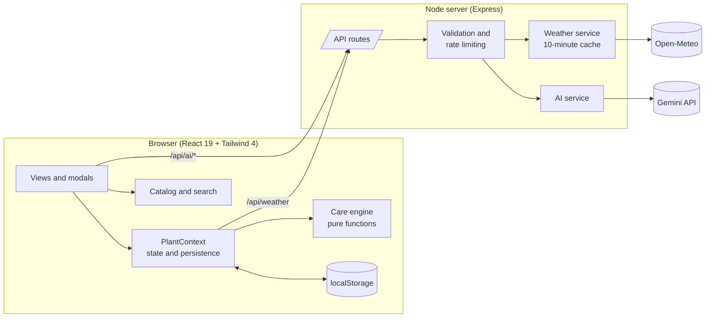

# Plantzy

**One routine for all your plants.** Plantzy turns a mixed collection of houseplants, balcony pots and garden plants into a single daily checklist, and explains why each task is on it today.

[](https://github.com/aarnarathod114-lab/Plantzy/actions/workflows/ci.yml)
[](LICENSE)


---

## The problem

Most plant apps are calendars: *water the monstera every seven days*. Plants do not drink on a calendar. How fast a pot dries depends on the pot, the soil, the light, the season and this week's weather, so fixed reminders lead people to water soil that is still wet. A tulsi on a hot balcony and a snake plant in a dim hallway need opposite treatment, and a reminder that fires for both on the same day is wrong for at least one of them.

Plantzy is built on a different rule:

> **Check before you water.** The app's job is to tell you *when to look* and *why*, then learn from what you find.

## What it does

| | |
|---|---|
| **One daily routine** | Every plant's needs are merged into one checklist grouped by task, with a time estimate and a "Why today?" explanation on each item. |
| **Soil-first scheduling** | Tasks are soil *checks*, not watering orders. You record what you find (very dry, slightly dry, moist, very wet) and the schedule adapts per pot. |
| **Weather awareness** | Live local weather tightens or relaxes the routine: heat, rain, low humidity, cold nights and high UV each change what is asked of you. |
| **1,012-plant catalog** | Houseplants, succulents, flowers, herbs, vegetables, fruit, trees and bonsai, with strong coverage of Indian garden plants. Search by common, botanical or Hindi name. |
| **AI, when configured** | Identify a plant from a photo, get a cautious health review, or ask an assistant that sees your collection and local weather. Entirely optional. |
| **Calendar** | Past days show the care you logged, today shows the live routine, and future days show a projection. |
| **Insights** | Care streak, weekly activity and per-pot moisture patterns, all computed from your own logs. |
| **Plant sitter guide** | A plain-language handoff sheet generated from your actual plants, ready to copy and send. |
| **Local-first** | No account. Your collection lives in your browser. |

## Design principles

These three rules shape the code as much as the product.

1. **Check before you water.** The routine engine never emits "water this plant". It emits "check this soil, because…".
2. **Never invent data.** If the weather provider is down, the app says weather is unavailable and plans from your logs alone. If no AI key is configured, identification says so instead of guessing. Statistics come from recorded events or read zero. Several tests exist only to enforce this.
3. **Explain every task.** Each task carries the reason it was generated, so the reasoning can be inspected and disagreed with.

## Architecture



**The care engine is pure.** `generateDailyRoutine(plants, weather)` takes data and returns tasks. It has no I/O, no clock dependency beyond "now", and no framework imports, which is why it can be covered by fast unit tests and reused by the calendar projection.

**The server is thin and exists for two reasons:** it keeps the AI key off the client, and it normalises and caches weather. Everything else runs in the browser.

**State is local.** `PlantContext` owns the collection and writes it to `localStorage`, validating the shape on load so corrupted storage cannot crash the app.

### Project structure

```
api/
  index.ts             Vercel entry: exports the API as one serverless function
server/
  app.ts               The API: routes, security headers, error handling
  index.ts             Local entry: API plus frontend on one port
  config.ts            Environment parsing
  weather.ts           Geocoding, forecast normalisation, cache
  ai.ts                Gemini wrapper and prompts
  validation.ts        Input limits and model-output normalisation
  rateLimit.ts         In-memory fixed-window limiter
  resilience.ts        Timeouts and model fallback within a time budget
  offlineAssistant.ts  General guidance when AI is unavailable
src/
  utils/
    intelligence.ts    Care engine: routine, alerts, moisture trend
    schedule.ts        Forward projection for calendar and reminders
    insights.ts        Streaks and soil patterns from logged care
    catalogSearch.ts   Ranked, script-aware catalog search
    plantArt.ts        Deterministic SVG tiles
    image.ts           In-browser photo resizing before upload
  data/
    careProfiles.ts    50 care archetypes
    plantCatalog.ts    Catalog assembly
    plants/            13 collections
  context/             App state and persistence
  components/          Views and modals
tests/                 122 tests
```

## How the care engine decides

Each plant is evaluated every time the plants or the weather change. The main rules:

| Situation | What Plantzy does | Why |
|---|---|---|
| No soil check logged yet | Ask for a first reading | The adaptive schedule needs a baseline |
| Indoor, default | Soil check every 3 days | Top few centimetres typically dry in 3–4 days |
| Indoor, soil moist in 2 of the last 3 checks | Stretch to every 5 days | This pot holds water; checking less protects roots |
| Indoor, soil very dry in 2 of the last 3 checks | Tighten to every 2 days | This pot dries fast |
| Indoor, low-light plant | Every 7 days | Low light means slow water use |
| Indoor, humidity-loving plant and air under 45% humidity | Every 2 days | Dry air speeds surface drying |
| Outdoor, rain chance 40% or more | Check before watering | Rain may do the job; avoid waterlogging |
| Outdoor, 28 °C or hotter | Check daily | Heat accelerates moisture loss |
| Outdoor herbs | Check daily | Small pots in sun dry within a day |
| Last reading was very dry | Mark the check urgent | |
| Indoor plant, 14 days since last rotation | Quarter-turn | Plants lean toward their light |
| Plant kept in a dim spot | Move toward brighter light | |
| Flowering plant, 7 days since last grooming | Deadhead | Redirects energy from seed to new buds |
| Tender outdoor plant, night forecast 12 °C or lower | Urgent: move indoors tonight | Chill stress |

The moisture-trend rule is the adaptive part: it is driven by what the user actually observes in each pot, not by species averages.

Two engine bugs found and fixed while building the test suite are worth noting, because both only appear with a large catalog:

- A substring match on `"rose"` scheduled rose-style deadheading for **Rosemary**, Desert Rose and Rose Apple. Roses are now detected by genus.
- Any plant whose notes mentioned deadheading received the task **every day**. Grooming now recurs weekly from the last logged prune.

## The plant catalog

1,012 plants across eight categories:

| Category | Plants | | Category | Plants |
|---|---:|---|---|---:|
| Flowering | 254 | | Tropical | 88 |
| Foliage | 232 | | Herbs | 58 |
| Succulents and cacti | 175 | | Medicinal | 55 |
| Fruit and vegetables | 118 | | Bonsai | 32 |

### Care archetypes

Writing complete care data by hand for a thousand plants produces inconsistency: three philodendrons end up with three different soil recipes. Plantzy models care the way horticulture does, by growth habit. There are 50 archetypes (climbing aroid, prayer plant, desert cactus, forest cactus, cool-season annual, fruiting vegetable, tropical bonsai and so on), and each catalog entry is a compact row that references one and overrides only what differs:

```ts
...group('aroidClimber', 'foliage', 'indoor', [
  ['Philodendron Micans', 'Philodendron hederaceum "Micans"',
   'Velvet leaves mark easily; avoid misting and handle little.'],
  ['Philodendron Verrucosum', 'Philodendron verrucosum',
   'Needs steady humidity and warmth; leaf edges crisp quickly in dry air.',
   { humidityPreference: 'high' }],
]),
```

Every plant still has its own care tip, which states what is specific to that plant. Adding a plant is a one-line change; see [CONTRIBUTING.md](CONTRIBUTING.md).

### Integrity

`tests/catalog.test.ts` runs against the whole catalog and fails the build on duplicate ids, common names or botanical names; missing or untrimmed fields; invalid light, humidity or category values; and temperature ranges that do not parse or are inverted.

### Search

`searchCatalog` matches every query token against common, botanical and vernacular names, and ranks whole-word matches above prefixes above substrings. Searching `rose` returns roses before rosemary; `mon` returns monstera before lemon. Latin diacritics and apostrophes are ignored (`nurnberg`, `birds nest`), while Devanagari is preserved so `तुलसी` works. Normalised strings are cached per plant, and results render in pages of 60.

### Images

The 152 original entries use photographs. The rest use deterministic SVG tiles generated in `plantArt.ts`, one glyph per category with tint and tilt varied by a hash of the plant id. The same generator is the fallback whenever a remote photo fails to load.

## Getting started

Requires Node.js 22.12 or newer.

```bash
git clone https://github.com/aarnarathod114-lab/Plantzy.git
cd Plantzy
npm install
npm run dev
```

Open <http://localhost:3000>. The app starts with a demo collection whose dates are shifted to the present on load, so the demo never looks stale.

Plantzy runs without any configuration. To enable the AI features, copy `.env.example` to `.env` and add a Gemini API key.

### Environment variables

| Variable | Default | Purpose |
|---|---|---|
| `GEMINI_API_KEY` | *(empty)* | Enables identification, health check and the assistant. Server-side only. |
| `GEMINI_MODEL` | `gemini-3.8-flash` | Preferred model for all three AI features. |
| `GEMINI_FALLBACK_MODELS` | `gemini-3.7-flash,gemini-3.5-flash` | Tried in order when the preferred model is overloaded, rate limited or slow. |
| `PORT` | `3000` | Port the server listens on. |
| `TRUST_PROXY` | `0` | Set to `1` behind a reverse proxy so rate limits use the real client IP. Automatic on Vercel. |
| `AI_RATE_LIMIT_PER_MINUTE` | `20` | AI requests allowed per IP per minute. |

### Scripts

| Command | What it does |
|---|---|
| `npm run dev` | Express with Vite middleware and hot reload |
| `npm run build` | Production build of the client into `dist/` |
| `npm start` | Serve `dist/` and the API in production mode |
| `npm test` | Run the test suite |
| `npm run typecheck` | `tsc --noEmit` |
| `npm run check` | Typecheck, test and build |

### Deploying

**Vercel.** The repository is ready to import as-is: `vercel.json` builds the client with Vite, serves it as static files, and routes `/api/*` to a single serverless function (`api/index.ts`) that wraps the same Express app used locally.

1. Import the repository at <https://vercel.com/new>. The defaults are correct.
2. Optionally add `GEMINI_API_KEY` under *Settings → Environment Variables* to enable the AI features, then redeploy.

On serverless hosts the weather cache and rate limiter are per instance, so they are best-effort rather than exact.

**Any Node host** (Render, Railway, Fly.io, a VPS). Plantzy also runs as one long-lived process:

```bash
npm install && npm run build
npm start
```

Set `GEMINI_API_KEY` in the host's secret store and `TRUST_PROXY=1` if the host puts a proxy in front of the app.

## API

All responses are JSON. Errors have the shape `{ "success": false, "error": "<code>", "message": "<human readable>" }`.

| Route | Purpose | Notable responses |
|---|---|---|
| `GET /api/health` | Liveness and whether AI is enabled | `200 { ok, aiEnabled }` |
| `GET /api/weather?city=` or `?lat=&lon=` | Current conditions and a 7-day forecast | `404 city_not_found`, `502 upstream_unavailable` |
| `POST /api/ai/identify` | Identify a plant from `imageBase64` and/or `description` | `503 ai_not_configured`, `422 not_identified`, `502 ai_unavailable` |
| `POST /api/ai/health-check` | Cautious review from a photo and/or symptoms | `isFallback: true` when it returns the general checklist |
| `POST /api/ai/assistant` | Answer a `question` given `userContext` | `isFallback: true` when it returns general guidance |

AI routes are limited per IP and return `429 rate_limited` with a `Retry-After` header.

## Testing

```bash
npm test
```

122 tests run on Node's built-in test runner in about two seconds, with no test framework dependency.

| Suite | Covers |
|---|---|
| `intelligence.test.ts` | Every scheduling rule above, weather thresholds, moisture trend, rose and basil detection, behaviour with no weather |
| `insights.test.ts` | Streak and weekly counts, soil patterns, schedule projection, calendar history, demo date shifting, photo sizing |
| `catalog.test.ts` | Integrity of all 1,012 entries and 50 archetypes, id generation, image generation |
| `catalogSearch.test.ts` | Ranking, multi-script matching, filters, a per-keystroke time budget |
| `server.test.ts` | Rate limiter, input validation, model-output normalisation, geocoding choice, forecast mapping, weather cache and failure paths, model fallback and time budget |

Time-dependent logic takes `now` as a parameter, and the weather service takes `fetch` as a dependency, so tests never touch the network or the real clock.

CI runs typecheck, tests and a production build on every push and pull request.

## Security and privacy

- **The API key never reaches the browser.** All model calls go through the server.
- **Your data stays on your device.** The collection is stored in `localStorage`. The server stores nothing. A photo or question is sent to the server, and on to the model provider, only when you use an AI feature.
- **Inputs are bounded and validated.** Text fields are length-capped and stripped of control characters. Uploads must be JPEG, PNG, WebP or HEIC, valid base64, and under 8 MB.
- **Photos are resized in the browser** to 1280 px before upload, and a 480 px copy is what gets stored with a plant. A 10 MB phone photo becomes a request of a few hundred kilobytes.
- **Model output is not trusted.** Responses are parsed and normalised: enum fields are coerced to known values, confidence is clamped to 0–100, and a missing confidence is treated as zero.
- **Prompt-injection hygiene.** User-supplied text and context are passed as delimited data, and the system instruction tells the model to treat them as data.
- **Model fallback.** Hosted models are sometimes overloaded. Each AI request tries the preferred model, then the fallbacks, inside a fixed time budget that is shorter than the host's request limit, so a busy model costs a few seconds rather than the feature.
- **Rate limiting** on AI and weather routes, with a cap on tracked keys so the limiter cannot be used to exhaust memory.
- **Security headers:** a Content-Security-Policy in production, `X-Content-Type-Options`, `X-Frame-Options`, `Referrer-Policy` and `Permissions-Policy`.

### Responsible AI

Plant identification and health assessment from a photo are uncertain, and the product treats them that way. Identification shows the model's confidence and asks you to check the name before adding. Health reviews are prompted to list possible factors rather than issue a diagnosis, and always start with checking soil and light. When the model is unavailable the app shows a clearly labelled general checklist and states that your photo was not analysed.

## Known limitations

- **Single device.** There are no accounts or sync. Clearing browser storage clears your collection.
- **No push notifications.** Reminder times and quiet hours are saved, but nothing is delivered outside the open app yet.
- **Temperatures display in Celsius** even when Fahrenheit is selected in settings.
- **Vacation mode produces the sitter guide only.** It does not yet change the routine.
- **Fertilizing is not scheduled.** Feeding guidance is shown per plant but does not generate tasks.
- **Photo reuse.** Some of the original catalog entries share stock photographs that do not show that exact plant.
- **Care data is general guidance** written for typical conditions. Local climate, pot and soil matter more, which is why the engine leans on your own soil checks.
- **TypeScript `strict` mode is not enabled** in the project config yet.
- **The rate limiter and weather cache are in-memory**, which is exact for one process, best-effort on serverless, and would need a shared store to scale out.

## Roadmap

- Push reminders through a service worker, honouring quiet hours
- Optional account with encrypted sync across devices
- Pet-safety flags on every catalog entry, sourced from a veterinary reference
- Fertilizing and repotting cadence in the routine engine
- Seasonal adjustment by hemisphere and climate zone
- Fahrenheit display and full interface translation
- Accessibility audit: focus management in modals, keyboard paths, contrast
- Verified photographs for catalog entries

## Contributing

Plant additions and rule improvements are welcome. See [CONTRIBUTING.md](CONTRIBUTING.md).

## Acknowledgements

Weather data by [Open-Meteo](https://open-meteo.com/). Icons by [Lucide](https://lucide.dev/). Catalog photographs from [Unsplash](https://unsplash.com/). Built with React, Vite, Tailwind CSS and Express.

## License

[MIT](LICENSE) © Aarna Rathod
